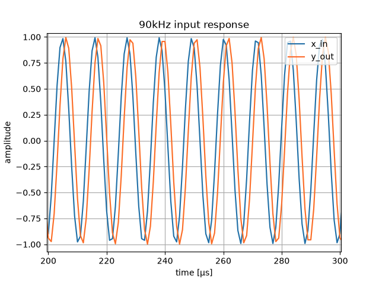
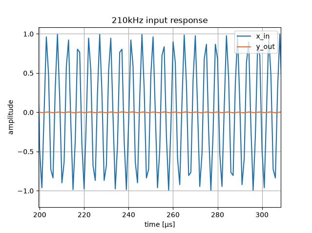

# 24-Tap FIR Low-Pass Filter (Verilog)

A fully parallel 24-tap FIR low-pass filter in Verilog, with a testbench that streams a sine test vector through the filter and logs the response to CSV.

## Specification

| Parameter        | Value                          |
|------------------|--------------------------------|
| Sample rate (fs) | 1 MHz                          |
| Passband         | 100 kHz                        |
| Stopband         | 200 kHz                        |
| Taps             | 24   |
| Input            | 8-bit signed                   |
| Coefficients     | 16-bit signed, Q15             |
| Output           | 26-bit signed                  |

## Architecture

```
x_in ──► [x0]─►[x1]─►[x2]─► … ─►[x23]     24-stage shift register (advances on sample_in)
          │     │     │           │
         ×c0   ×c1   ×c2   …     ×c23     24 parallel multipliers
          └─────┴─────┴─────┬─────┘
                            Σ                adder tree (combinational)
                            │
                         [y_out]             output register
```

- **Direct-form, fully parallel:** a new output is produced on every sample.

- **`sample_in` clock enable:** the filter runs off the system clock and only advances when a new sample is valid.

- **Asynchronous active-low reset** clears the delay line and output.

- **Bit growth:** each 8×16 product is 24 bits, widened by 2 bits as a margin against overflow. 

- **Coefficients** are loaded from `taps.hex` with `$readmemh`, so the response can be changed without touching the RTL.

- **Tap count:** the 24 multiply-accumulate terms are written out explicitly, so `TAPS` is fixed at 24.

### Coefficient design

The coefficients were designed in MATLAB FDATool with the **equiripple method**. They were then quantized to 16-bit signed and exported to `taps.hex`. Negative taps are kept as two's complement and handled by signed arithmetic.

## Verification

The testbench (`FIRlow24_tb.v`):

1. Loads an 8-bit sine test vector (`sin_f0kHz.hex`) with `$readmemh`
2. Resets the filter, then streams 1000 samples at 1 MHz
3. Writes `t_ns, x_in, y_out` to `y_out_LPF24.csv` and dumps a VCD waveform

The input signals are unit-amplitude sine waves quantized to 8-bit signed samples (scaled by 127).

To characterize the filter, I ran the simulation four times by hand, once per test frequency (90, 110, 180 and 210 kHz). 

### Results

Measured steady-state gain:

| Input freq | Band       | Gain  | Attenuation |
|------------|------------|-------|-------------|
| 90 kHz     | Passband   | 1.006 | ≈ 0 dB      |
| 110 kHz    | Edge       | 0.960 | −0.4 dB     |
| 180 kHz    | Transition | 0.110 | −19 dB      |
| 210 kHz    | Stopband   | 0.007 | −44 dB      |

Both signals are normalized to ±1.

**90 kHz (passband):** the output follows the input at full amplitude.



**210 kHz (stopband):** the output is attenuated.



## Running the simulation

Requires [Icarus Verilog](https://steveicarus.github.io/iverilog/). Run from this directory so the `.hex` files are found:

```sh
iverilog -o sim FIRlow24.v FIRlow24_tb.v
vvp sim
gtkwave firLPF24.vcd   # optional: view waveforms
```

## Files

| File                | Description                                 |
|---------------------|---------------------------------------------|
| `FIRlow24.v`        | Filter RTL (module `FIRlow24`)              |
| `FIRlow24_tb.v`     | Testbench                                   |
| `taps.hex`          | 24 Q15 filter coefficients                  |
| `sin_f0kHz.hex`    | 8-bit sine test vectors (90/110/180/210 kHz)|

## Possible improvements


- Replace the hand-written sum with a `generate` loop so `TAPS` can be varied
- Round/saturate the output back to a narrower width
- Self-checking testbench comparing against a golden reference model

